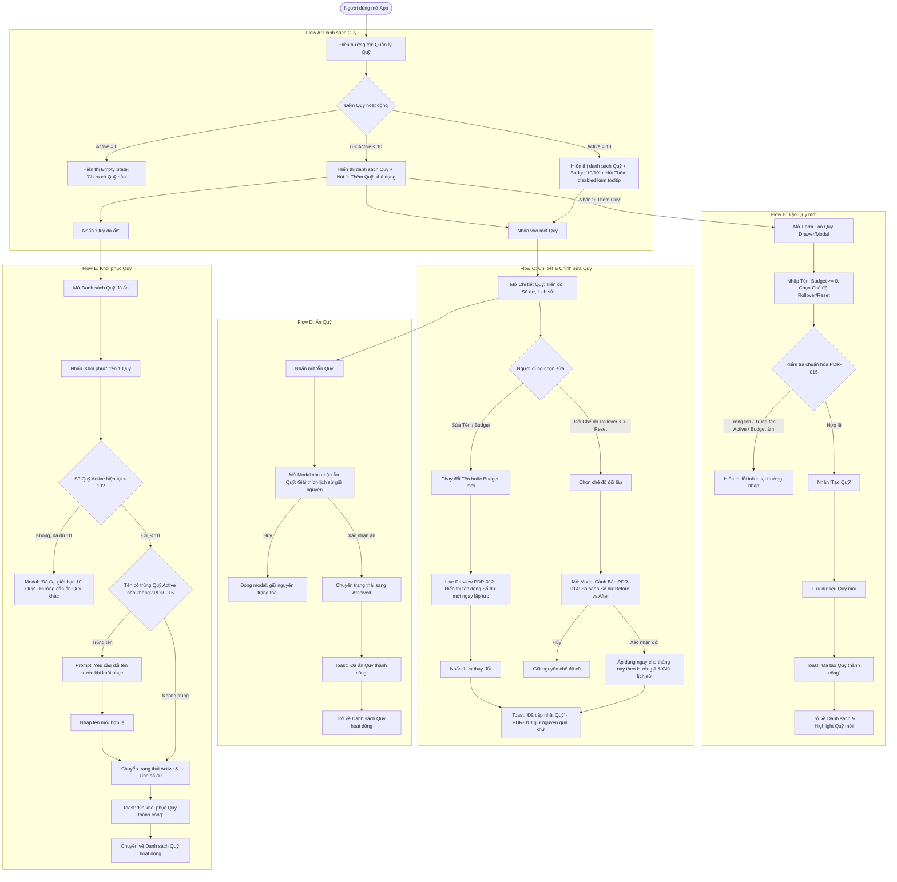
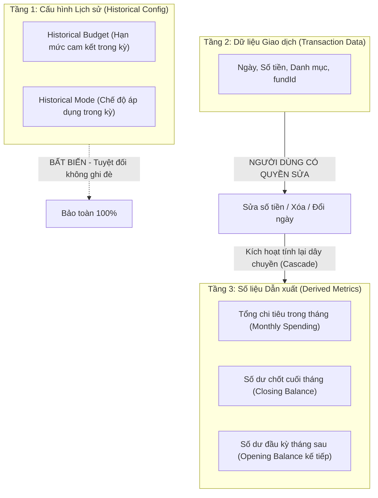

# UX Flow & Interaction Architecture: Quản lý Quỹ (Fund Management)
## Dự án: QL_ThuChi (Personal Expense Tracker)

---

## 1. Vai trò & Mục tiêu UX

Tài liệu này đặc tả toàn bộ kiến trúc tương tác, luồng người dùng (UX Flows), công thức tính toán tài chính, nguyên tắc xử lý trạng thái và giao diện cho chức năng **Quản lý Quỹ** trong ứng dụng **QL_ThuChi**.

Tài liệu này tuân thủ các quyết định đã được Product Owner (PO) xác nhận:
* **PDR-008**: Khái niệm Quỹ & Quan hệ `0..1` với Giao dịch.
* **PDR-009**: Giới hạn tối đa 10 Quỹ hoạt động & Cơ chế Ẩn/Khôi phục thay cho Xóa vĩnh viễn.
* **PDR-010**: Hai chế độ ngân sách: Cộng dồn (`rollover`) và Đặt lại (`reset`).
* **PDR-011**: Hạn mức bằng 0 ₫ và Số dư âm cho phép, không chặn giao dịch.
* **PDR-012**: Chỉnh sửa Budget áp dụng ngay cho tháng hiện tại kèm Live Preview.
* **PDR-013 (Confirmed)**: Bảo toàn Budget và số dư lịch sử của các tháng đã kết thúc.
* **PDR-014 (Confirmed)**: Đổi chế độ ngân sách áp dụng tức thì cho tháng hiện tại kèm Preview Before/After & Bảo toàn lịch sử.
* **PDR-015 (Confirmed)**: Tên Quỹ duy nhất trong danh sách Quỹ đang hoạt động (chuẩn hóa trim & case-insensitive).
* **PDR-016 (Confirmed)**: Mục Quỹ trong thanh điều hướng chính (Navigation) mà không làm suy giảm tốc độ ghi chép nhanh dưới 5 giây.

---

## 2. Thuật ngữ & Mô hình Khái niệm (Terminology & Mental Model)

### 2.1. Bảng thuật ngữ tài chính chuẩn hóa (Standard Terminology)

Nhằm đảm bảo người dùng và hệ thống không nhầm lẫn giữa *Hạn mức cấp trong tháng* với *Số tiền thực tế còn có thể chi tiêu*, ứng dụng quy chuẩn các thuật ngữ sau:

| Thuật ngữ | Tiếng Anh | Định nghĩa & Ý nghĩa nghiệp vụ |
|---|---|---|
| **Ngân sách tháng (Hạn mức)** | `Budget` / `Monthly Budget` | Số tiền được phân bổ cho một Quỹ trong một chu kỳ tháng (có thể bằng `0 ₫`). Đây là **hạn mức chi tiêu**, không đồng nhất với số dư thực tế. |
| **Số dư đầu kỳ** | `Opening Balance` | Số dư tài chính được chuyển tiếp từ tháng trước sang tháng này (chỉ áp dụng ở chế độ `rollover`; bằng `0 ₫` ở chế độ `reset`). Có thể là số dương (tiết kiệm) hoặc số âm (nợ/bội chi). |
| **Tổng chi trong tháng** | `Monthly Spending` | Tổng số tiền của các giao dịch chi tiêu được gán vào Quỹ trong tháng đang xét (`amount > 0`). |
| **Số dư hiện tại** | `Current Balance` | Số tiền khả dụng thực tế của Quỹ tính đến thời điểm hiện tại trong tháng. Có thể âm nếu chi tiêu vượt hạn mức. |
| **Số dư cuối kỳ** | `Closing Balance` | Số dư chốt sổ tại thời khắc kết thúc tháng (`23:59:59` ngày cuối tháng). Giá trị này trở thành bất biến sau khi tháng đã đóng. |
| **Budget lịch sử** | `Historical Budget` | Hạn mức Budget đã từng áp dụng cho một tháng đã kết thúc trong quá khứ. Tuyệt đối không bị ghi đè khi sửa Budget hiện tại. |
| **Quỹ đang hoạt động** | `Active Fund` | Quỹ đang trong trạng thái sử dụng bình thường, xuất hiện trong danh sách Quản lý Quỹ và trong dropdown chọn Quỹ khi ghi giao dịch mới. Tối đa 10 Quỹ. |
| **Quỹ đã ẩn** | `Hidden Fund` / `Archived Fund` | Quỹ đã tạm dừng sử dụng. Vẫn lưu trữ 100% dữ liệu và lịch sử giao dịch nhưng không xuất hiện khi tạo giao dịch mới. Có thể khôi phục. |

### 2.2. Phân biệt `Mục` (Category) vs `Quỹ` (Fund)
* **`Mục` (Category)**: Phân loại bản chất giao dịch — *Khoản tiền chi ra/thu vào cho cái gì?* (Ví dụ: Ăn uống, Tiền điện, Cà phê, Mua sắm).
* **`Quỹ` (Fund)**: Nguồn ngân sách chịu trách nhiệm chi trả — *Khoản tiền nào gánh khoản chi này?* (Ví dụ: Quỹ Sinh hoạt, Quỹ Đãi tiệc, Quỹ Mua sắm).

### 2.3. Mối quan hệ giữa Giao dịch và Quỹ
* Một giao dịch có thể:
  1. **Không thuộc Quỹ nào** (Chi tiêu tự do ngoài ngân sách kế hoạch).
  2. **Thuộc tối đa 1 Quỹ** (Quan hệ `0..1`).
* **Không ép buộc**: Người dùng không bắt buộc phải chọn Quỹ khi ghi nhận thu chi. Tùy chọn Quỹ luôn là một trường bổ trợ linh hoạt.

---

## 3. Kiến trúc Thông tin & Điểm tiếp cận (Information Architecture)

```
[ App Root ]
   │
   ├── [1. Bottom Nav (Mobile) / Top Nav (Desktop)] ── (PDR-016 Confirmed)
   │     ├── Tab 1: Tổng quan (Dashboard) ──▶ Widget tóm tắt Quỹ ngân sách
   │     ├── Tab 2: Sổ giao dịch (Ledger)  ──▶ Filter theo Quỹ; hiển thị tag '(Đã ẩn)' cho Quỹ cũ
   │     ├── Action Center: [+ Chi] / [+ Thu] ──▶ Nút nổi trung tâm (Giữ vững tốc độ < 5s)
   │     ├── Tab 3: Quản lý Quỹ (Funds)   ──▶ [ENTRY POINT CHÍNH]
   │     │     ├── Header: Bộ chọn tháng & Chỉ số tổng quan ngân sách
   │     │     ├── Tab con: Quỹ đang hoạt động (Tối đa 10 Quỹ - Badge N/10)
   │     │     │     ├── Nút "+ Thêm Quỹ" (Disabled khi đạt 10/10)
   │     │     │     └── Danh sách Card Quỹ (Budget, Đã chi, Số dư, Progress Bar)
   │     │     └── Tab con / Link: Quỹ đã ẩn (Lưu trữ)
   │     │           └── Danh sách Card Quỹ ẩn & Nút "Khôi phục" (Kèm Capacity Check)
   │     └── Tab 4: Báo cáo (Reports)
   │
   ├── [2. Drawer Thêm/Sửa Giao dịch]
   │     └── Trường chọn Quỹ (Dropdown / Chips: "Không gắn Quỹ" + 10 Quỹ active; Ẩn Quỹ archived)
   │
   └── [3. Màn hình Chi tiết / Chỉnh sửa Quỹ]
         ├── Thông tin Quỹ & Diễn giải công thức số dư
         ├── Form Sửa Tên (Validate Unique PDR-015) & Sửa Budget (Live Preview PDR-012, PDR-013)
         ├── Đổi Chế độ Ngân sách (Modal Before/After PDR-014)
         ├── Danh sách giao dịch thuộc Quỹ trong tháng
         └── Nút "Ẩn Quỹ" (Dialog cảnh báo an toàn lịch sử)
```

---

## 4. Sơ đồ Wireflow Tổng thể (Mermaid Diagram)



---

## 5. Đặc tả Chi tiết 5 UX Flows (Chuẩn 10 Tiêu chí)

### 5.1. FLOW A: Danh sách Quỹ (Fund List & Overview)

#### 1. Entry Point
* Người dùng chạm vào tab **"Quỹ"** trên Bottom Navigation (Mobile) hoặc Top Navigation (Desktop).
* Hoặc từ widget tóm tắt Quỹ trên Dashboard (nhấn "Xem tất cả").

#### 2. User Goal
* Nắm bắt tức thì tình hình ngân sách của các Quỹ trong tháng hiện tại: hạn mức bao nhiêu, đã chi bao nhiêu, còn lại bao nhiêu, có quỹ nào bội chi không.
* Dễ dàng điều hướng để tạo Quỹ mới, chỉnh sửa Quỹ hoặc xem lại các Quỹ đã ẩn.

#### 3. Main Flow
1. Người dùng mở trang Danh sách Quỹ.
2. Hệ thống tải dữ liệu các Quỹ đang hoạt động của tháng hiện tại.
3. Thanh Header hiển thị:
   * Tiêu đề: **Quản lý Quỹ** kèm bộ chọn tháng (mặc định tháng hiện tại, e.g. `Tháng 10/2026`).
   * Chỉ số tổng quan: `Tổng ngân sách Quỹ`, `Đã chi`, `Số dư khả dụng`.
   * Số lượng Quỹ hoạt động: Pill badge ví dụ `4/10 Quỹ đang dùng`.
   * CTA chính: Nút `+ Thêm Quỹ` (khả dụng nếu `< 10`, disabled kèm tooltip nếu `= 10`).
4. Danh sách các thẻ Quỹ (Fund Cards) hiển thị theo thứ bậc:
   * **Tên Quỹ** (e.g. `Quỹ Sinh Hoạt`).
   * **Tag Chế độ**: Chip nhỏ `Cộng dồn` (Icon mũi tên vòng) hoặc `Đặt lại mỗi tháng` (Icon làm mới).
   * **Thanh tiến độ ngân sách (Progress bar)**:
     * Dưới 80%: Màu xanh thương hiệu (`Trust Blue`).
     * Từ 80% – 100%: Màu cảnh báo hổ phách (`Amber`).
     * Vượt 100%: Màu đỏ hồng (`Rose`), thanh full + icon cảnh báo viền.
   * **Thông tin số liệu 3 cột**:
     * Ngân sách tháng: `1.500.000 ₫`
     * Đã chi: `800.000 ₫`
     * Số dư khả dụng: `+700.000 ₫` (hoặc `-200.000 ₫` màu Rose nếu âm).
5. Phía cuối danh sách có liên kết: `Quỹ đã ẩn (N) →` để chuyển sang danh sách lưu trữ.
6. Người dùng chạm vào bất kỳ thẻ Quỹ nào để chuyển sang Flow C (Chi tiết Quỹ).

#### 4. Alternative Flows
* **Chuyển tháng xem quá khứ**: Người dùng đổi sang tháng trước (e.g. `Tháng 09/2026`). Giao diện hiển thị đúng **Historical Budget** và **Closing Balance** đã chốt của tháng 9 (tuân thủ PDR-013). Nút sửa budget tháng quá khứ bị khóa hoặc có ghi chú *"Kỳ ngân sách đã kết thúc"*.
* **Đã đạt giới hạn 10 Quỹ**: Nút `+ Thêm Quỹ` chuyển sang trạng thái disabled (`opacity: 0.5`), khi hover hoặc tap hiển thị tooltip: *"Bạn đã dùng tối đa 10 Quỹ hoạt động. Hãy ẩn bớt một Quỹ để tạo mới."*

#### 5. Validation & Rules
* Số Quỹ hoạt động hiển thị không vượt quá 10.
* Tất cả số tiền hiển thị theo định dạng số nguyên VND, `tabular-nums`.
* Khi số dư âm: Bắt buộc có dấu trừ `-`, màu text Rose, đi kèm biểu tượng `AlertTriangle` và nhãn phụ `Vượt ngân sách`.

#### 6. Success State
* Dữ liệu tải mượt mà dưới 100ms. Thẻ Quỹ hiển thị đầy đủ thông tin, thanh tiến độ sinh động nhưng không gây rối mắt.

#### 7. Failure State
* **Lỗi truy xuất dữ liệu**: Hiển thị thẻ thông báo lỗi nhẹ: *"Không thể tải danh sách quỹ. Vui lòng thử lại."* kèm nút `[Tải lại]`.

#### 8. Cancellation Behavior
* Không áp dụng (màn hình xem danh sách).

#### 9. Edge Cases
* **Chưa có Quỹ nào (Zero Funds)**: Hiển thị Empty State thân thiện kèm nút `[+ Tạo Quỹ đầu tiên]`.
* **Budget = 0 ₫**:
  * Nếu chưa chi: Thanh tiến độ 0%, Số dư `0 ₫`.
  * Nếu đã chi (e.g. 50.000 ₫): Thanh tiến độ chuyển trạng thái Vượt ngân sách (Rose), Số dư `-50.000 ₫`.

#### 10. Data Impact
* Read-only. Không có dữ liệu nào bị thay đổi.

---

### 5.2. FLOW B: Tạo Quỹ mới (Create Fund)

#### 1. Entry Point
* Nhấn nút `+ Thêm Quỹ` từ màn hình Danh sách Quỹ (khi số quỹ active `< 10`).
* Nhấn `+ Tạo Quỹ đầu tiên` từ Empty State.

#### 2. User Goal
* Thiết lập một quỹ chi tiêu mới với tên duy nhất, hạn mức tháng mong muốn và chế độ ngân sách phù hợp trong dưới 10 giây.

#### 3. Main Flow
1. Người dùng nhấn `+ Thêm Quỹ`.
2. Mở biểu mẫu tạo Quỹ (Bottom Sheet trên Mobile, Modal Dialog trên Desktop).
3. Focus tự động vào trường **Tên Quỹ**:
   * Placeholder: `Ví dụ: Quỹ Sinh hoạt, Đãi tiệc...`
   * Giới hạn: Tối đa 40 ký tự. Có bộ đếm ký tự `0/40`.
4. Người dùng nhập **Ngân sách tháng (Budget)**:
   * Mặc định trống hoặc gợi ý `0 ₫`.
   * Bàn phím số tự động mở trên mobile (`inputMode="numeric"`).
   * Format tiền tệ trực tiếp theo thời gian thực (gõ `1500000` hiển thị `1.500.000 ₫`).
   * Gợi ý text phụ: *"Cho phép nhập 0 ₫ nếu chưa muốn cấp ngân sách cố định"*.
5. Người dùng chọn **Chế độ ngân sách (Budget Mode)**:
   * Trình bày dạng 2 Radio Card trực quan:
     * Card 1: **Cộng dồn (`rollover`)** (Khuyến nghị).
       * Subtitle: *"Tiền dư hoặc tiền bội chi tháng này được chuyển tiếp sang tháng sau."*
     * Card 2: **Đặt lại mỗi tháng (`reset`)**.
       * Subtitle: *"Mỗi tháng bắt đầu lại đúng bằng ngân sách cấp mới, không bù trừ tháng cũ."*
6. Người dùng nhấn `[Tạo Quỹ]`.
7. Hệ thống validate:
   * **Chuẩn hóa Tên Quỹ (PDR-015)**: `name.trim().toLowerCase()`. Kiểm tra trùng lặp với tất cả các Quỹ đang hoạt động.
   * Budget là số nguyên `>= 0`.
   * Tổng số quỹ hoạt động `< 10`.
8. Hệ thống lưu Quỹ mới vào cơ sở dữ liệu.
9. Đóng Sheet/Modal với hiệu ứng thu gọn mượt mà.
10. Hiển thị Toast thông báo: *"Đã tạo Quỹ Sinh hoạt thành công."*
11. Danh sách Quỹ tự động cuộn đến vị trí Quỹ mới tạo kèm viền sáng highlight 1.5s.

#### 4. Alternative Flows
* **Đóng không lưu khi form còn trống**: Nhấn `✕` hoặc click outside → Đóng ngay lập tức.
* **Đóng khi đã nhập dữ liệu (Dirty state)**: Nhấn `✕` → Hiển thị cảnh báo: *"Hủy tạo Quỹ? Dữ liệu bạn vừa nhập sẽ không được lưu."* với 2 nút: `[Tiếp tục sửa]` và `[Hủy bỏ]`.

#### 5. Validation & Rules (PDR-015 Confirmed)
* **Quy tắc Tên Quỹ**:
  * Bắt buộc nhập. Nếu rỗng: Báo lỗi inline *"Vui lòng nhập tên Quỹ"*.
  * Kiểm tra trùng lặp: Nếu sau khi trim và chuyển chữ thường, tên trùng với một Quỹ Active:
    * Báo lỗi inline cụ thể: *"Đã có Quỹ đang hoạt động tên '[Tên gốc]'. Vui lòng chọn tên khác để tránh nhầm lẫn."*
    * **Bảo vệ dữ liệu**: Tuyệt đối giữ nguyên Budget và Chế độ người dùng đã chọn trên form; không xóa form.
* **Quy tắc Budget**: Phải là số nguyên `>= 0`. Không cho phép số âm.
* **Kiểm tra giới hạn**: Nếu danh sách active đã đủ 10 Quỹ, chặn submit và thông báo rõ ràng.

#### 6. Success State
* Quỹ mới xuất hiện trong danh sách với số dư ban đầu `= monthlyBudget` (chưa có chi tiêu). Toast hiển thị 3 giây.

#### 7. Failure State
* Lỗi lưu trữ: Thông báo lỗi inline trên đầu form: *"Không thể lưu Quỹ do lỗi bộ nhớ. Vui lòng thử lại."* Giữ nguyên dữ liệu form.

#### 8. Cancellation Behavior
* Không lưu bất kỳ dữ liệu nào; quay lại danh sách bình thường.

#### 9. Edge Cases
* **Lỗi mạng/bộ nhớ khi kiểm tra trùng tên**: Nếu không thể tải danh sách Quỹ để check duplicate, hiển thị cảnh báo *"Không thể kiểm tra trùng tên lúc này. Vui lòng thử lại"* kèm nút thử lại; không âm thầm lưu đè.
* **Click đúp nút Tạo**: Nút tự động disabled và hiển thị spinner để tránh tạo bản ghi trùng lặp.

#### 10. Data Impact
* Tạo 1 bản ghi Quỹ mới (`status: 'ACTIVE'`, `monthlyBudget`, `budgetMode`, `createdAt: now`).

---

### 5.3. FLOW C: Chi tiết và Chỉnh sửa Quỹ (Fund Detail & Edit)

#### 1. Entry Point
* Nhấn vào thẻ Quỹ bất kỳ trong màn hình Danh sách Quỹ (Flow A).

#### 2. User Goal
* Xem diễn giải công thức số dư và lịch sử chi tiêu của Quỹ trong tháng.
* Chỉnh sửa Tên Quỹ, điều chỉnh Budget hoặc Đổi chế độ ngân sách.

#### 3. Main Flow
1. Mở màn hình Chi tiết Quỹ.
2. **Khu vực 1 — Hero Card Tổng quan số dư**:
   * Tên Quỹ, Tag Chế độ (`Cộng dồn` / `Đặt lại`).
   * Số dư hiện tại (`Current Balance`).
   * Hạn mức tháng này: `Budget` | Đã chi: `Monthly Spending`.
   * Diễn giải công thức:
     * *Nếu Quỹ Cộng dồn*: `Số dư = Đầu kỳ (Opening) + Hạn mức (Budget) - Đã chi (Spending)`.
     * *Nếu Quỹ Đặt lại*: `Số dư = Hạn mức (Budget) - Đã chi (Spending)`.
3. **Khu vực 2 — Form Chỉnh sửa thông tin**:
   * **Trường Tên Quỹ**: Sửa tên (áp dụng validate PDR-015).
   * **Trường Budget**: Cho phép nhập số mới.
   * **Live Impact Preview (PDR-012 Confirmed)**: Khi người dùng thay đổi Budget từ `1.500.000` thành `2.000.000`:
     * Hiển thị ngay nhãn tính toán:
       * *Số dư hiện tại:* `1.400.000 ₫` ➔ *Số dư mới sau khi lưu:* `1.900.000 ₫` (Chênh lệch: `+500.000 ₫`).
   * **Trường Chế độ Ngân sách**: Nút chuyển đổi giữa `Cộng dồn` và `Đặt lại`. Nhấn đổi sẽ kích hoạt Modal xác nhận PDR-014.
4. **Khu vực 3 — Danh sách giao dịch thuộc Quỹ trong tháng**:
   * Danh sách các khoản chi gắn với Quỹ, kèm ngày và số tiền.
5. **Khu vực 4 — Hành động**:
   * Nút phụ: `[Ẩn Quỹ này]`.
   * Nút chính: `[Lưu thay đổi]`.
6. Người dùng nhấn `[Lưu thay đổi]` → Cập nhật thành công → Toast: *"Đã cập nhật Quỹ thành công"*.

#### 4. Alternative Flows
* **Thay đổi Chế độ Ngân sách (PDR-014 Confirmed)**:
  1. Người dùng chọn đổi chế độ (`rollover` ↔ `reset`).
  2. Mở **Hộp thoại Xác nhận Tác động Tài chính (Impact Modal)**:
     * Tiêu đề: *"Thay đổi chế độ ngân sách Quỹ"*
     * Trình bày rõ ràng:
       * Chế độ cũ ➔ Chế độ mới.
       * Cảnh báo: Chế độ mới áp dụng ngay trong tháng hiện tại.
       * **Bảng so sánh số dư Before vs After**:
         * *Số dư hiện tại:* `1.400.000 ₫`
         * *Số dư mới dự kiến:* `700.000 ₫` (Giảm `700.000 ₫` do không cộng dồn từ tháng trước).
       * Cam kết: *Toàn bộ giao dịch đã ghi nhận và lịch sử các tháng đã kết thúc được giữ nguyên vẹn (PDR-013, PDR-014).*
     * Nút 1: `[Giữ nguyên chế độ cũ]` (Hủy).
     * Nút 2: `[Xác nhận chuyển đổi]` (Áp dụng).
* **Người dùng thoát khi form bẩn**: Cảnh báo *"Bỏ qua các thay đổi chưa lưu?"*.

#### 5. Validation & Rules
* Tên Quỹ: Chuẩn hóa trim & case-insensitive, không trùng Quỹ Active khác (PDR-015).
* Budget: Số nguyên `>= 0`.
* **Bảo toàn lịch sử (PDR-013 Confirmed)**: Thay đổi Budget chỉ áp dụng từ tháng hiện tại và tương lai. Không hồi tố vào các tháng đã kết thúc. Khoản đã chi trong tháng không bị thay đổi.

#### 6. Success State
* Lưu dữ liệu thành công. Mọi con số cập nhật đồng bộ. Toast phản hồi rõ ràng.

#### 7. Failure State
* Lỗi ghi dữ liệu: Giữ nguyên form, hiển thị thông báo lỗi: *"Không thể lưu thay đổi do lỗi bộ nhớ. Vui lòng thử lại."*

#### 8. Cancellation Behavior
* Khôi phục toàn bộ giá trị ban đầu.

#### 9. Edge Cases
* **Đổi chế độ nhiều lần trong cùng tháng**: Xem chi tiết tại Mục 7 (Áp dụng Hướng A — tính lại tháng hiện tại theo cấu hình hiện hành từ Opening Balance gốc).
* **Sửa Budget về 0 ₫ khi đã có khoản chi**: Hợp lệ. Số dư lập tức tính lại thành số âm đúng bằng tổng chi.

#### 10. Data Impact
* Cập nhật bản ghi Quỹ (`name`, `monthlyBudget`, `budgetMode`, `updatedAt: now`).
* **Không sửa đổi bất kỳ giao dịch nào**. Không thay đổi số dư lịch sử của các tháng đã kết thúc.

---

### 5.4. FLOW D: Ẩn Quỹ (Archive Fund)

#### 1. Entry Point
* Nhấn nút `[Ẩn Quỹ này]` ở cuối màn hình Chi tiết Quỹ (Flow C).
* Hoặc từ menu `···` trên thẻ Quỹ tại Danh sách Quỹ.

#### 2. User Goal
* Tạm ngừng sử dụng Quỹ mà **không làm mất lịch sử giao dịch**.

#### 3. Main Flow
1. Người dùng kích hoạt thao tác Ẩn Quỹ.
2. Hệ thống mở **Hộp thoại Xác nhận Ẩn Quỹ**.
3. Nội dung hộp thoại:
   * Tiêu đề: *"Ẩn Quỹ [Tên Quỹ]?"*
   * Icon: `Archive` (Hổ phách, không dùng thùng rác màu đỏ).
   * Cam kết rõ ràng:
     * ✓ *Toàn bộ giao dịch và lịch sử chi tiêu của Quỹ vẫn được giữ nguyên đầy đủ.*
     * ✓ *Quỹ này sẽ không còn xuất hiện khi bạn thêm giao dịch mới.*
     * ✓ *Bạn có thể khôi phục lại Quỹ này bất kỳ lúc nào từ mục 'Quỹ đã ẩn'.*
   * Nếu Quỹ đang âm: Thông báo nhẹ *"Quỹ đang bội chi (-250.000 ₫). Ẩn quỹ không làm mất khoản bội chi này trong báo cáo lịch sử."* (Không bắt buộc trả nợ trước khi ẩn).
4. Hành động:
   * Nút phụ: `[Hủy bỏ]`.
   * Nút chính: `[Xác nhận ẩn]`.
5. Người dùng nhấn `[Xác nhận ẩn]`.
6. Hệ thống cập nhật: `status = 'ARCHIVED'`.
7. Đóng hộp thoại, quay lại Danh sách Quỹ hoạt động.
8. Quỹ biến mất khỏi danh sách hoạt động; số lượng Quỹ giảm đi 1 (e.g. `10/10` ➔ `9/10`).
9. Toast thông báo: *"Đã ẩn Quỹ [Tên Quỹ]."* kèm link `[Hoàn tác]` (5 giây).

#### 4. Alternative Flows
* **Nhấn [Hoàn tác] trên Toast**: Khôi phục Quỹ ngay về `ACTIVE`.
* **Nhấn [Hủy bỏ] trong Dialog**: Đóng dialog, giữ nguyên màn hình.

#### 5. Validation & Rules
* Không đòi hỏi số dư bằng 0 để được ẩn.
* Không tự động chuyển giao dịch cũ sang Quỹ khác.

#### 6. Success State
* Quỹ chuyển sang Archived. Nút `+ Thêm Quỹ` (nếu từng disabled) nay được kích hoạt lại.

#### 7. Failure State
* Lỗi: Báo lỗi *"Không thể ẩn Quỹ lúc này. Vui lòng thử lại."*

#### 8. Cancellation Behavior
* Không có thay đổi nào xảy ra.

#### 9. Edge Cases
* **Ẩn Quỹ duy nhất còn lại**: Danh sách chuyển về Empty State của Flow A.
* **Giao dịch cũ sau khi ẩn**: Tiếp tục hiển thị tên Quỹ bình thường kèm badge nhỏ `(Đã ẩn)` trong Sổ giao dịch (xem chi tiết Mục 8).

#### 10. Data Impact
* Chỉ cập nhật thuộc tính Quỹ: `status: 'ARCHIVED'`, `updatedAt: now`.
* **Tuyệt đối không xóa bất kỳ giao dịch nào**. Giữ nguyên liên kết `fundId`.

---

### 5.5. FLOW E: Khôi phục Quỹ (Restore Fund)

#### 1. Entry Point
* Từ Danh sách Quỹ (Flow A), nhấn vào liên kết `Quỹ đã ẩn (N) →`.

#### 2. User Goal
* Khôi phục một Quỹ đã ẩn trở lại danh sách hoạt động.

#### 3. Main Flow
1. Người dùng mở màn hình **"Quỹ đã ẩn"**.
2. Danh sách hiển thị các Quỹ có `status = 'ARCHIVED'`:
   * Tên Quỹ, Chế độ cũ, Budget cũ, Ngày ẩn.
   * Nút hành động: `[Khôi phục]`.
3. Người dùng chạm vào `[Khôi phục]`.
4. **Kiểm tra năng lực (Capacity Check)**:
   * Nếu `activeCount < 10`: Tiếp tục bước 5.
   * Nếu `activeCount >= 10`: Mở Modal cảnh báo giới hạn (xem Alternative Flow).
5. **Kiểm tra trùng tên (PDR-015 Confirmed)**:
   * Chuẩn hóa tên Quỹ ẩn: `name.trim().toLowerCase()`.
   * So sánh với danh sách các Quỹ đang Active:
     * **Nếu KHÔNG trùng tên**: Chuyển trạng thái `status = 'ACTIVE'`, tính lại số dư tháng hiện tại, Toast thành công, điều hướng về Flow A.
     * **Nếu TRÙNG TÊN với 1 Quỹ Active**: Mở Prompt yêu cầu đổi tên (xem bước 6).
6. **Xử lý xung đột tên (PDR-015 Rename Prompt)**:
   * Mở Dialog: *"Đổi tên Quỹ để khôi phục"*
   * Nội dung: *"Đã có Quỹ đang hoạt động tên '[Tên Quỹ]'. Vui lòng nhập tên mới để hoàn tất khôi phục."*
   * Input trường Tên Quỹ mới (autofocus, gợi ý ví dụ `[Tên Quỹ] (Cũ)`).
   * Người dùng nhập tên mới hợp lệ ➔ Nhấn `[Xác nhận khôi phục]`.
   * Hệ thống cập nhật tên mới và chuyển `status = 'ACTIVE'`.
   * Toast: *"Đã khôi phục Quỹ với tên mới thành công."*

#### 4. Alternative Flows
* **ĐÃ ĐẠT GIỚI HẠN 10 QUỸ HOẠT ĐỘNG (`activeCount >= 10`)**:
  * Mở Hộp thoại Thông báo Giới hạn:
    * Tiêu đề: *"Đã đạt giới hạn 10 Quỹ hoạt động"*
    * Nội dung: *"Ứng dụng hiện chỉ hỗ trợ tối đa 10 Quỹ hoạt động cùng lúc. Để khôi phục Quỹ này, bạn cần ẩn bớt một Quỹ đang hoạt động khác trước."*
    * Nút 1: `[Đóng]`. Nút 2: `[Quản lý Quỹ hoạt động]` (Chuyển sang Flow A).
  * **Tuyệt đối không tự ý ẩn Quỹ khác**.

#### 5. Validation & Rules
* Kiểm tra nghiêm ngặt `activeFunds.length < 10` và không trùng tên Active trước khi kích hoạt.

#### 6. Success State
* Quỹ trở lại Active, xuất hiện trong dropdown chọn Quỹ khi ghi giao dịch mới.

#### 7. Failure State
* Lỗi: Báo lỗi *"Không thể khôi phục Quỹ lúc này. Vui lòng thử lại."*

#### 8. Cancellation Behavior
* Đóng hộp thoại, giữ nguyên trạng thái Archived.

#### 9. Edge Cases
* **Danh sách Quỹ đã ẩn trống**: Hiển thị Empty State *"Không có Quỹ nào đang ẩn."*

#### 10. Data Impact
* Cập nhật Quỹ: `status: 'ACTIVE'`, `name` (nếu đổi tên), `updatedAt: now`. Không đổi lịch sử giao dịch.

---

## 6. Đặc tả Công thức Tính toán Số dư & Chuyển giao Liên kỳ (Budget Calculation Engine)

### 6.1. Công thức Toán học Chuẩn hóa

#### A. Trong Cùng Một Chu kỳ Tháng ($M$)
* **Tổng chi tiêu trong tháng**:
  $$\text{Monthly Spending} = \sum_{t \in \text{Tháng } M, \text{txn.fundId} = \text{fund.id}} \text{txn.amount}$$
* **Số dư hiện tại theo Chế độ Cộng dồn (`rollover`)**:
  $$\text{Current Balance} = \text{Opening Balance}_{(M)} + \text{Active Budget}_{(M)} - \text{Monthly Spending}_{(M)}$$
* **Số dư hiện tại theo Chế độ Đặt lại (`reset`)**:
  $$\text{Current Balance} = \text{Active Budget}_{(M)} - \text{Monthly Spending}_{(M)}$$
* **Số dư chốt cuối tháng (`Closing Balance`)**:
  * Nếu tháng $M$ áp dụng `rollover`: $\text{Closing Balance}_{(M)} = \text{Opening Balance}_{(M)} + \text{Budget}_{(M)} - \text{Monthly Spending}_{(M)}$
  * Nếu tháng $M$ áp dụng `reset`: $\text{Closing Balance}_{(M)} = \text{Budget}_{(M)} - \text{Monthly Spending}_{(M)}$

---

### 6.2. Quy tắc Chuyển Số dư Giữa các Tháng (Target-Month Rules — PDR-022 Confirmed)

Xét hai chu kỳ tháng liên tiếp: Tháng trước ($M$) đã kết thúc và Tháng tiếp theo ($M+1$) bắt đầu. 

#### Bảng Quy Tắc Cốt Lõi (Target-Month Rule)
**Chế độ của tháng đích ($M+1$) quyết định Opening Balance của chính tháng đó:**

| Mode tháng M+1 | Opening Balance tháng M+1 | Diễn giải tài chính |
|---|---|---|
| `rollover` | `Closing Balance` tháng M | Kế thừa trọn vẹn số dư cuối kỳ tháng trước (cả thặng dư, âm nợ hay bằng 0). |
| `reset` | `0 ₫` | Bắt đầu lại từ 0 ₫, không chuyển số dư tháng trước sang. |

* **Tính đối xứng tuyệt đối**: Quy tắc áp dụng hoàn toàn đối xứng cho số dư dương ($> 0$), số dư âm ($< 0$) và số dư bằng 0 ($= 0$).
* **Bốn chuỗi chuyển đổi chế độ liên kỳ**:
  1. `rollover → rollover`: Kế thừa số dư cuối kỳ tháng trước, bao gồm thặng dư và bội chi.
  2. `rollover → reset`: Tháng đích bắt đầu từ `0 ₫`.
  3. `reset → rollover`: **Tháng đích vẫn nhận Closing Balance của tháng trước!**
  4. `reset → reset`: Tháng đích bắt đầu từ `0 ₫`.
* **Nguyên tắc giải thích cốt lõi (Không ngộ nhận Reset)**:
  > **Không diễn giải Reset là xóa vĩnh viễn Closing Balance của tháng đó.**
  > Chế độ `reset` chỉ quy định `Opening Balance` của chính tháng Reset đó bằng `0 ₫`. Số dư chốt cuối kỳ của tháng Reset vẫn được tính toán và lưu vết đầy đủ theo công thức $\text{Closing Balance}_M = \text{Budget}_M - \text{Spending}_M$. Nếu tháng kế tiếp ($M+1$) được cấu hình là `rollover`, tháng $M+1$ sẽ nhận `Closing Balance` của tháng $M$ làm vốn đầu kỳ.

#### Tác động khi đổi chế độ ở tháng hiện tại ($M$):
* Khi tháng $M$ đổi chế độ, `Current Balance` tháng $M$ thay đổi ngay lập tức theo Mô hình A (PDR-017).
* Khi tháng $M$ kết thúc, `Closing Balance` của tháng $M$ được chốt theo chế độ cuối cùng đang active tại thời điểm đóng sổ.
* Đầu kỳ của tháng $M+1$ sẽ được tính toán dựa trên `Closing Balance` chốt đó theo quy tắc Target-Month ở trên.

---

## 7. Phân tích Chuyên sâu: Đổi Chế độ Ngân sách trong Tháng & Kiểm chứng Ma trận Số học (PDR-017 Confirmed)

### 7.1. Nguyên tắc Mô hình A (Calendar Month Level — PDR-017 Confirmed)

* Khi thay đổi Budget hoặc Mode trong tháng hiện tại, **số dư phải được tính lại từ dữ liệu nguồn theo cấu hình cuối cùng đang có hiệu lực**.
* **Quy tắc tính toán**:
  * Nếu Mode hiện hành là `rollover`: `Opening Balance` lấy từ `Closing Balance` của tháng liền trước theo PDR-022.
  * Nếu Mode hiện hành là `reset`: `Opening Balance` = `0 ₫`.
  * `Current Balance` = `Opening Balance` + `Monthly Budget` − `Monthly Spending`.
* **Năm bất biến nghiệp vụ bắt buộc**:
  1. Thay đổi Budget không làm thay đổi các giao dịch đã ghi nhận.
  2. Thay đổi Mode không cộng dồn chênh lệch qua các lần thao tác trước.
  3. Chuỗi thay đổi `rollover → reset → rollover` phải cho kết quả cuối cùng hoàn toàn giống với việc tính toán trực tiếp với cấu hình cuối cùng là `rollover`.
  4. Các thao tác thay đổi Budget và Mode xen kẽ phải cho kết quả tất định (deterministic), không phụ thuộc lịch sử thao tác.
  5. Không sửa cấu hình hoặc số liệu dẫn xuất của tháng đã kết thúc chỉ vì người dùng thay đổi Budget/Mode của tháng hiện tại.
* **Phân định rõ ranh giới dữ liệu**:
  * *Dữ liệu nguồn (Source Data)*: Các bản ghi giao dịch gốc (`amount`, `date`, `fundId`), Cấu hình Budget/Mode hiện hành, Cấu hình lịch sử tháng cũ.
  * *Số liệu dẫn xuất (Derived Metrics)*: `Opening Balance`, `Monthly Spending`, `Current Balance`, `Closing Balance`.
  * **Tuyệt đối không lưu số dư trung gian như dữ liệu gốc**.

---

### 7.2. Kiểm chứng Số học: Ma trận Kiểm thử Toàn diện

#### Nhóm A: Đổi Budget/Mode trong cùng một tháng (Tháng hiện tại $M$, Opening gốc từ $M-1$)

| Mã SC | Tình huống kiểm tra | Dữ liệu đầu vào | Thao tác thực hiện | Số dư TRƯỚC thay đổi | Công thức & Số dư SAU thay đổi | Kết quả kiểm chứng nghiệp vụ |
|:---:|---|---|---|---|---|---|
| **SC-A1** | `rollover → reset → rollover` | Opening T9 = `+500k`<br>Budget = `2.0M`<br>Spending = `600k` | Đổi Rollover ➔ Reset ➔ Rollover | **B1 (Roll):** `+1.9M`<br>**B2 (Reset):** `+1.4M` | **B3 (Roll):**<br>**`+1.900.000 ₫`**<br>*(500k + 2M - 600k)* | **Khôi phục nguyên vẹn 1.9M**. Độc lập hoàn toàn với bước trung gian Reset. |
| **SC-A2** | `reset → rollover → reset` | Opening T9 = `+700k`<br>Budget = `1.5M`<br>Spending = `400k` | Đổi Reset ➔ Rollover ➔ Reset | **B1 (Reset):** `+1.1M`<br>**B2 (Roll):** `+1.8M` | **B3 (Reset):**<br>**`+1.100.000 ₫`**<br>*(0 + 1.5M - 400k)* | **Khôi phục nguyên vẹn 1.1M**. Không bị lưu rác hay cộng dồn thừa số dư. |
| **SC-A3** | Tăng Budget, giảm Budget, rồi đổi Mode | Opening T9 = `+400k`<br>Budget gốc = `1.0M`<br>Spending = `300k` | 1. Tăng Budget lên `1.5M`<br>2. Giảm Budget về `1.2M`<br>3. Đổi sang `reset` | **Gốc (Roll):** `+1.1M`<br>**Sau b1:** `+1.6M`<br>**Sau b2:** `+1.3M` | **Sau b3 (Reset):**<br>**`+900.000 ₫`**<br>*(0 + 1.2M - 300k)* | Số dư tính lại trực tiếp từ Budget cuối `1.2M` và Mode cuối `reset`. |
| **SC-A4** | Budget bằng 0 ₫ | Opening T9 = `+600k`<br>Budget = `0 ₫`<br>Spending = `250k` | Đổi từ `rollover` sang `reset` | **`+350.000 ₫`**<br>*(600k + 0 - 250k)* | **`-250.000 ₫`**<br>*(0 + 0 - 250k)* | PDR-011: Budget = 0 ₫ hoạt động như rổ theo dõi chi tiêu thuần túy. Số dư âm đúng bằng chi tiêu. |
| **SC-A5** | Budget thấp hơn Spending | Opening T9 = `0 ₫` (Reset)<br>Budget = `2.0M`<br>Spending = `1.4M` | Giảm Budget xuống `1.0M` (thấp hơn 1.4M đã chi) | **`+600.000 ₫`**<br>*(2M - 1.4M)* | **`-400.000 ₫`**<br>*(1M - 1.4M)* | Số dư âm tức thì (-400k). Cảnh báo Rose. Không chặn người dùng ghi chép tiếp. |
| **SC-A6** | Opening Balance âm (Tháng trước bội chi) | Opening T9 = `-400k`<br>Budget = `1.5M`<br>Spending = `600k` | Đổi từ `rollover` sang `reset` | **`+500.000 ₫`**<br>*(-400k + 1.5M - 600k)* | **`+900.000 ₫`**<br>*(0 + 1.5M - 600k)* | Khi chuyển sang Reset, số dư tăng +400k vì tháng mới được xóa nợ ngân sách cũ. |
| **SC-A7** | Spending bằng 0 ₫ (Chưa phát sinh chi tiêu) | Opening T9 = `+300k`<br>Budget = `2.0M`<br>Spending = `0 ₫` | Đổi từ `rollover` sang `reset` | **`+2.300.000 ₫`**<br>*(300k + 2M - 0)* | **`+2.000.000 ₫`**<br>*(0 + 2M - 0)* | Số dư bằng đúng nguyên vẹn Budget tháng này khi ở Reset. |
| **SC-A8** | Nhiều giao dịch đã tồn tại trước khi đổi Mode | Opening T9 = `+300k`<br>Budget = `1.0M`<br>4 txns: 100k, 250k, 150k, 200k (Spending = `700k`) | Đổi từ `rollover` sang `reset` | **`+600.000 ₫`**<br>*(300k + 1M - 700k)* | **`+300.000 ₫`**<br>*(0 + 1M - 700k)* | Toàn bộ 700k chi tiêu được tính đủ. Không giao dịch nào bị thất lạc. |
| **SC-A9** | Đổi Mode nhiều lần nhưng không phát sinh giao dịch mới | Opening T9 = `+200k`<br>Budget = `1.0M`<br>Spending = `500k` (cố định) | Bấm đổi Rollover ➔ Reset ➔ Rollover ➔ Reset liên tục | Thay đổi qua lại giữa `700k` và `500k` | **`+500.000 ₫`**<br>*(0 + 1M - 500k)* | Số dư luôn ổn định tuyệt đối tại 500k khi ở Reset và 700k khi ở Rollover. |

---

#### Nhóm B: Chuyển số dư giữa hai tháng liên tiếp ($M \rightarrow M+1$ theo Target-Month Rules PDR-022)

Ma trận 12 ví dụ số học bao quát đủ 4 chuỗi chuyển đổi với cả 3 trạng thái của Closing Balance tháng $M$ (Dương $>0$, Âm $<0$, Bằng không $=0$).
*Giả định: Tháng $M$ có $\text{Budget}_M = 2.000.000\text{ ₫}$; Tháng $M+1$ có $\text{Budget}_{M+1} = 1.500.000\text{ ₫}$.*

| Mã SC | Chuỗi chuyển đổi | Chi tiêu Tháng $M$ | Closing Balance Tháng $M$ | Opening Balance Tháng $M+1$ | Current Balance Tháng $M+1$ (đầu tháng, chi = 0) | Ý nghĩa kiểm chứng |
|:---:|---|:---:|:---:|:---:|:---:|---|
| **SC-B01** | `rollover → rollover` | `1.200.000 ₫` | **`+800.000 ₫`** (Dương) | **`+800.000 ₫`** | **`+2.300.000 ₫`** *(800k + 1.5M)* | Chuyển toàn bộ thặng dư sang tăng hạn mức. |
| **SC-B02** | `rollover → rollover` | `2.400.000 ₫` | **`-400.000 ₫`** (Âm) | **`-400.000 ₫`** | **`+1.100.000 ₫`** *(-400k + 1.5M)* | Khấu trừ thâm hụt vào hạn mức mới. |
| **SC-B03** | `rollover → rollover` | `2.000.000 ₫` | **`0 ₫`** (Bằng 0) | **`0 ₫`** | **`+1.500.000 ₫`** *(0 + 1.5M)* | Số dư chuyển tiếp bằng 0. |
| **SC-B04** | `rollover → reset` | `1.200.000 ₫` | **`+800.000 ₫`** (Dương) | **`0 ₫`** | **`+1.500.000 ₫`** *(0 + 1.5M)* | Thặng dư lưu ở tháng cũ; tháng mới làm mới hoàn toàn. |
| **SC-B05** | `rollover → reset` | `2.400.000 ₫` | **`-400.000 ₫`** (Âm) | **`0 ₫`** | **`+1.500.000 ₫`** *(0 + 1.5M)* | Xóa nợ ngân sách cũ trong tháng mới. |
| **SC-B06** | `rollover → reset` | `2.000.000 ₫` | **`0 ₫`** (Bằng 0) | **`0 ₫`** | **`+1.500.000 ₫`** *(0 + 1.5M)* | Bắt đầu trọn vẹn 1.5M. |
| **SC-B07** | `reset → rollover` | `1.300.000 ₫` | **`+700.000 ₫`** (Dương) | **`+700.000 ₫`** | **`+2.200.000 ₫`** *(700k + 1.5M)* | **PDR-022**: Tháng $M+1$ là Rollover nên nhận Closing Balance (+700k) của tháng Reset $M$! |
| **SC-B08** | `reset → rollover` | `2.300.000 ₫` | **`-300.000 ₫`** (Âm) | **`-300.000 ₫`** | **`+1.200.000 ₫`** *(-300k + 1.5M)* | **PDR-022**: Tháng $M+1$ là Rollover nên gánh tiếp khoản âm (-300k) từ tháng Reset $M$! |
| **SC-B09** | `reset → rollover` | `2.000.000 ₫` | **`0 ₫`** (Bằng 0) | **`0 ₫`** | **`+1.500.000 ₫`** *(0 + 1.5M)* | Nhận Closing Balance = 0 ₫. |
| **SC-B10** | `reset → reset` | `1.300.000 ₫` | **`+700.000 ₫`** (Dương) | **`0 ₫`** | **`+1.500.000 ₫`** *(0 + 1.5M)* | Độc lập tuyệt đối. |
| **SC-B11** | `reset → reset` | `2.300.000 ₫` | **`-300.000 ₫`** (Âm) | **`0 ₫`** | **`+1.500.000 ₫`** *(0 + 1.5M)* | Độc lập tuyệt đối. |
| **SC-B12** | `reset → reset` | `2.000.000 ₫` | **`0 ₫`** (Bằng 0) | **`0 ₫`** | **`+1.500.000 ₫`** *(0 + 1.5M)* | Độc lập tuyệt đối. |

---

## 8. Sửa Giao Dịch Lịch Sử & Tính Lại Dây Chuyền (Cascade Recalculation — PDR-019 Confirmed)

### 8.1. Ba Tầng Dữ Liệu & Quy Trình Tính Lại 7 Bước



#### Quy trình tính toán dây chuyền 7 bước chuẩn:
1. **Bảo toàn cấu hình**: Giữ nguyên `Historical Budget` và `Historical Mode` của các tháng bị ảnh hưởng.
2. **Tính lại tháng trực tiếp**: Tính lại `Monthly Spending` và `Closing Balance` của tháng có giao dịch bị sửa đổi ($M-k$).
3. **Xác định phạm vi ảnh hưởng tiếp theo**: Dò xét tháng kế tiếp ($M-k+1$) theo PDR-022.
4. **Nếu tháng kế tiếp là `rollover`**: Cập nhật `Opening Balance` mới = `Closing Balance` vừa tính lại của tháng trước; tính lại `Closing Balance` của tháng đó.
5. **Nếu tháng kế tiếp là `reset`**: `Opening Balance` của tháng đó bằng `0 ₫`; thay đổi số dư từ tháng trước **chặn lại tại ranh giới này, không lan truyền tiếp**.
6. **Lặp lại chuỗi lan truyền**: Tiếp tục tính toán theo cùng quy tắc cho các tháng sau cho đến khi gặp một tháng `reset` hoặc đến tháng hiện tại.
7. **Bảo toàn dữ liệu không liên quan**: Không sửa đổi bất kỳ giao dịch không liên quan nào và không ghi đè cấu hình lịch sử của bất kỳ tháng nào.

---

### 8.2. Kiểm Chứng Số Học: Các Trường Hợp Sửa Giao Dịch Lịch Sử

| Mã TC | Tình huống kiểm thử | Dữ liệu ban đầu | Hành động sửa đổi | Kết quả tính lại tháng cũ | Tác động sang tháng kế tiếp & Chuỗi lan truyền |
|:---:|---|---|---|---|---|
| **SC-C01** | Sửa số tiền LÀM TĂNG Spending | T9 ($M-1$): Budget 2M, Chi ban đầu 1.2M $\rightarrow$ Closing T9 = `+800k` | Sửa Tx1 từ 500k lên 1.0M (+500k chi tiêu) | Chi T9: $1.7M$.<br>Closing T9: **`+300.000 ₫`** (Giảm 500k). | **Nếu T10 là Rollover**: Opening T10 giảm từ 800k ➔ `+300.000 ₫`. Current Balance T10 giảm đúng 500k. |
| **SC-C02** | Sửa số tiền LÀM GIẢM Spending | T9 ($M-1$): Budget 2M, Chi ban đầu 1.5M $\rightarrow$ Closing T9 = `+500k` | Sửa Tx1 từ 600k xuống 200k (-400k chi tiêu) | Chi T9: $1.1M$.<br>Closing T9: **`+900.000 ₫`** (Tăng 400k). | **Nếu T10 là Rollover**: Opening T10 tăng từ 500k ➔ `+900.000 ₫`. Current Balance T10 tăng đúng 400k. |
| **SC-C03** | Xóa một giao dịch cũ | T9 ($M-1$): Budget 2M, Chi ban đầu 1.4M (gồm Tx1 300k) $\rightarrow$ Closing T9 = `+600k` | Xóa Tx1 (300k) | Chi T9: $1.1M$.<br>Closing T9: **`+900.000 ₫`** (Tăng 300k). | **Nếu T10 là Rollover**: Opening T10 cập nhật thành `+900.000 ₫`. |
| **SC-C04** | Chuyển ngày giao dịch sang tháng khác | T9: Tx1 400k (ngày 28/09). T10: Spending hiện tại 500k. | Đổi ngày Tx1 sang 02/10 (Tháng 10) | T9: Spending giảm 400k, Closing T9 tăng 400k. | T10: Spending tăng 400k. Nếu T10 là Rollover, nhận Opening tăng 400k $\rightarrow$ bù trừ cân bằng. |
| **SC-C05** | Tháng tiếp theo dùng `reset` | T9: Closing cũ = +800k, sau sửa = +300k. T10 dùng `reset`. | Sửa giao dịch T9 | Closing T9 giảm 500k. | **T10 dùng Reset**: Opening T10 vẫn là `0 ₫`. Thay đổi số dư T9 **dừng lại tại ranh giới T10**, không lan truyền sang T10. |
| **SC-C06** | Chuỗi nhiều tháng `rollover` liên tiếp | T8: Rollover, T9: Rollover, T10: Rollover. | Sửa giao dịch tại Tháng 8 (+200k spending) | Closing T8 giảm 200k. | Opening T9 giảm 200k ➔ Closing T9 giảm 200k ➔ Opening T10 giảm 200k ➔ Current Balance T10 giảm 200k. |
| **SC-C07** | Chuỗi có tháng `reset` ở giữa | T7: Rollover, T8: Reset, T9: Rollover, T10: Rollover. | Sửa giao dịch tại Tháng 7 (+300k spending) | Closing T7 giảm 300k. | **T8 dùng Reset**: Opening T8 = 0 ₫. Chuỗi lan truyền **dừng lại ngay tại T8**. T9 và T10 hoàn toàn không bị ảnh hưởng! |
| **SC-C08** | Sửa giao dịch ở tháng `reset`, tháng tiếp theo dùng `rollover` | T9 dùng `reset`, Closing cũ = +600k. T10 dùng `rollover`. | Sửa giao dịch T9 (+200k spending) | Closing T9 tính lại: $600k - 200k = \mathbf{+400.000\text{ ₫}}$. | **PDR-022**: T10 dùng Rollover nên nhận Closing T9 mới: Opening T10 cập nhật thành `+400.000 ₫` (giảm 200k). |

---

### 8.3. Đặc Tả Hộp Thoại Cảnh Báo UX Trước Khi Lưu Chỉnh Sửa Lịch Sử

Trước khi lưu bất kỳ chỉnh sửa giao dịch lịch sử nào có khả năng ảnh hưởng đến số dư các tháng khác, hệ thống **bắt buộc hiển thị Modal cảnh báo (Wireframe 8 & 9)** với nội dung chuẩn:

1. **Giao dịch đang sửa**: Tên giao dịch, ngày ban đầu, số tiền cũ ➔ số tiền mới.
2. **Tháng bị ảnh hưởng trực tiếp**: Nêu rõ Tháng $M-k$ đã đóng sổ.
3. **Phạm vi các tháng tiếp theo bị ảnh hưởng**: Liệt kê các tháng Rollover kế tiếp sẽ bị thay đổi số dư chuyển tiếp.
4. **Số dư trước và sau thay đổi**:
   * *Nếu xác định được chính xác*: Hiển thị rõ số dư cũ ➔ số dư mới dự kiến.
   * *Nếu chưa thể xác định đầy đủ tác động*: Phải nêu rõ giới hạn, **tuyệt đối không hiển thị số liệu giả định như kết quả đã tính chính xác**.
5. **Cam kết bảo toàn cấu hình**: Khẳng định rõ hạn mức Budget và Mode lịch sử của các tháng cũ được giữ nguyên vẹn 100%.
6. **Hành động người dùng**: `[Hủy bỏ]` (giữ nguyên giao dịch cũ) hoặc `[Xác nhận cập nhật]` (thực hiện lưu và tính lại dây chuyền).

---

## 9. Sửa Giao Dịch Liên Kết Với Quỹ Ẩn (Archived Fund Transactions — PDR-020 Confirmed)

Đặc tả chi tiết 7 trường hợp kiểm thử cho Quỹ ẩn và giao dịch liên kết theo các quyết định PO đã chốt:

| Mã TC | Tình huống kiểm thử | Hành vi hệ thống & UX chuẩn | Trạng thái nghiệp vụ |
|:---:|---|---|:---:|
| **TC-HF-01** | **Xem lại giao dịch cũ gắn Quỹ ẩn** | Trong Sổ giao dịch và Báo cáo, giao dịch vẫn hiển thị tên Quỹ bình thường kèm nhãn nhỏ `(Đã ẩn)`. Nhấp vào chi tiết vẫn xem được đầy đủ thông tin Quỹ. | **Confirmed** (PO đã chốt) |
| **TC-HF-02** | **Sửa số tiền giao dịch gắn Quỹ ẩn** | Cho phép sửa số tiền bình thường. Hệ thống tính lại chi tiêu và số dư lịch sử của Quỹ ẩn đó theo PDR-019. **Tuyệt đối không ép buộc khôi phục Quỹ**. | **Confirmed** (PO đã chốt) |
| **TC-HF-03** | **Sửa ghi chú hoặc trường khác của giao dịch gắn Quỹ ẩn** | Cho phép sửa ghi chú, danh mục bình thường mà không làm ảnh hưởng trạng thái ẩn của Quỹ. Không tự động đổi `fundId` thành `null`. | **Confirmed** (PO đã chốt) |
| **TC-HF-04** | **Tạo giao dịch mới** | Mở dropdown Quỹ khi thêm giao dịch mới: **Quỹ ẩn tuyệt đối không xuất hiện trong danh sách**. Người dùng chỉ thấy các Quỹ đang Active (tối đa 10 Quỹ). | **Confirmed** (PO đã chốt) |
| **TC-HF-05** | **Chuyển giao dịch từ Quỹ ẩn sang Quỹ khác** | Mở form sửa giao dịch: Nếu người dùng muốn đổi Quỹ, dropdown chỉ hiển thị các Quỹ Active. Khi lưu, giao dịch chuyển sang Quỹ Active mới, hoàn trả chi tiêu cho Quỹ ẩn. | **Confirmed** (PO đã chốt) |
| **TC-HF-06** | **Khôi phục Quỹ sau khi ẩn** | Khi khôi phục Quỹ: Mọi giao dịch lịch sử gắn với Quỹ trước đó vẫn giữ nguyên vẹn liên kết `fundId`. Kiểm tra giới hạn 10 Quỹ và kiểm tra trùng tên (PDR-009, PDR-015). | **Confirmed** (PO đã chốt) |
| **TC-HF-07** | **Báo cáo và tổng hợp Quỹ ẩn** | Báo cáo chi tiêu tháng quá khứ vẫn tổng hợp đầy đủ số tiền của các giao dịch gắn Quỹ ẩn. Quỹ ẩn được gom nhóm chính xác trong biểu đồ phân bổ danh mục/quỹ. | **Confirmed** (PO đã chốt) |


---

## 10. Rà soát Điều hướng (Navigation Audit - PDR-016 Confirmed)

### 10.1. Mobile Navigation (< 768px)
* **Cấu trúc Bottom Navigation (4 Tabs + Floating Action Center)**:
  ```text
  [ 🏠 Tổng quan ]   [ 📋 Sổ giao dịch ]   ( + CHI | + THU )   [ 💼 Quỹ ]   [ 📊 Báo cáo ]
  ```
* **Bảo vệ tiêu chuẩn dưới 5 giây**:
  * Nút `+ Chi` và `+ Thu` được bố trí nổi bật ở vị trí trung tâm vùng ngón tay cái (Thumb zone).
  * Người dùng có thể ghi nhận khoản chi chỉ bằng 1 chạm từ bất kỳ đâu mà **không phải đi qua màn hình Quản lý Quỹ**.
  * Tab `Quỹ` (Icon SVG `Wallet`) có kích thước chạm tối thiểu `48x48px`, nhãn chữ rõ ràng, hiển thị badge chấm đỏ nhẹ nếu có quỹ bội chi.

### 10.2. Desktop Navigation (>= 768px)
* **Cấu trúc Top Navigation Bar**:
  * Các mục đồng cấp: `Tổng quan` | `Sổ giao dịch` | `Quản lý Quỹ` | `Báo cáo` | `Cài đặt`.
  * Mục `Quản lý Quỹ` có trạng thái active rõ ràng (`border-bottom` xanh thương hiệu + chữ sáng Slate-50).
  * Phía trên góc phải trang Quỹ có liên kết nhanh sang `Quỹ đã ẩn`.

---

## 11. Rà soát Validation Tên Quỹ Duy Nhất (PDR-015 Confirmed)

* **Thời điểm kiểm tra**:
  1. Khi người dùng rời khỏi ô nhập tên (`onBlur`).
  2. Khi người dùng nhấn nút Submit Form (`onSubmit`).
* **Quy trình chuẩn hóa chuỗi (Normalization)**:
  * Loại bỏ khoảng trắng đầu và cuối chuỗi (`.trim()`).
  * Chuyển toàn bộ về chữ thường (`.toLowerCase()`).
  * So sánh với tập hợp tên chuẩn hóa của tất cả các Quỹ đang có `status = 'ACTIVE'`.
* **Phản hồi lỗi & Bảo vệ dữ liệu**:
  * Lỗi hiển thị inline ngay dưới trường nhập: *"Tên Quỹ '[Tên gốc]' đã tồn tại trong danh sách Quỹ đang hoạt động. Vui lòng chọn tên khác."*
  * Không dùng popup alert của trình duyệt.
  * Toàn bộ dữ liệu Budget và Chế độ người dùng đã nhập trên form được **giữ nguyên 100%**, người dùng chỉ cần sửa lại tên và bấm lưu.

---

## 12. Tiêu chí Nghiệm thu UX (Acceptance Criteria Checklist)

- [x] **AC-01 (Đầy đủ 5 Flow)**: Cả 5 Flow A, B, C, D, E được đặc tả đầy đủ theo chuẩn 10 tiêu chí.
- [x] **AC-02 (Quy tắc 0..1 Quỹ)**: Giao dịch không bắt buộc gắn Quỹ; thuộc tối đa 1 Quỹ (PDR-008 Confirmed).
- [x] **AC-03 (Giới hạn 10 Quỹ)**: Chặn tạo mới và khôi phục khi đã đủ 10 Quỹ active; không tự ý ẩn Quỹ khác (PDR-009 Confirmed).
- [x] **AC-04 (Budget = 0 ₫ & Âm)**: Cho phép Budget = 0 ₫; số dư âm không chặn ghi giao dịch (PDR-011 Confirmed).
- [x] **AC-05 (Sửa Budget có Live Preview)**: Sửa Budget tính lại số dư tháng hiện tại ngay lập tức, có Preview Before/After (PDR-012 Confirmed).
- [x] **AC-06 (Bảo toàn Lịch sử Budget)**: Không hồi tố Budget mới vào các tháng đã kết thúc; giữ nguyên số dư quá khứ (PDR-013 Confirmed).
- [x] **AC-07 (Đổi Chế độ tức thì & Bảo toàn)**: Đổi chế độ áp dụng ngay tháng này kèm Impact Modal; giữ nguyên lịch sử quá khứ (PDR-014 Confirmed).
- [x] **AC-08 (Tên Quỹ duy nhất)**: Chuẩn hóa trim & case-insensitive, validate trong tạo/sửa/khôi phục; giữ nguyên dirty form khi lỗi (PDR-015 Confirmed).
- [x] **AC-09 (Điều hướng Quỹ chuẩn)**: Tab Quỹ xuất hiện trong Bottom/Top Nav, bảo toàn tuyệt đối tốc độ ghi Thu/Chi dưới 5 giây (PDR-016 Confirmed).
- [x] **AC-10 (Bảng tính kiểm chứng số học)**: Kiểm chứng bằng ma trận 9 kịch bản đổi mode/budget trong tháng và 12 kịch bản chuyển tiếp 4 chuỗi giữa 2 tháng (PDR-017 & PDR-022 Confirmed).
- [x] **AC-11 (Bảo toàn Lịch sử & Cascade Recalculation)**: Phân biệt rõ Cấu hình Lịch sử (bất biến), Dữ liệu Giao dịch (sửa được) và Số liệu Dẫn xuất (tính lại tự động); quy trình lan truyền 7 bước và Modal cảnh báo UX (PDR-013 & PDR-019 Confirmed).
- [x] **AC-12 (Ma trận Test 7 kịch bản Quỹ Ẩn)**: Rà soát đầy đủ 7 kịch bản kiểm thử giao dịch lịch sử và quỹ đã ẩn, cho phép sửa giao dịch mà không ép khôi phục Quỹ (TC-HF-01 đến TC-HF-07 Confirmed theo PDR-020).
- [x] **AC-13 (Quy tắc Target-Month Rules PDR-022)**: Đặc tả chi tiết 4 chuỗi chuyển đổi giữa tháng M và M+1, khẳng định Reset không xóa vĩnh viễn Closing Balance và tính đối xứng hoàn toàn giữa dương, âm, bằng 0 (PDR-022 Confirmed).
- [x] **AC-14 (Ranh giới Scope)**: Tuyệt đối không sửa đổi mã nguồn trong `src/`, không tạo component hay migration trong nhiệm vụ tài liệu này.

